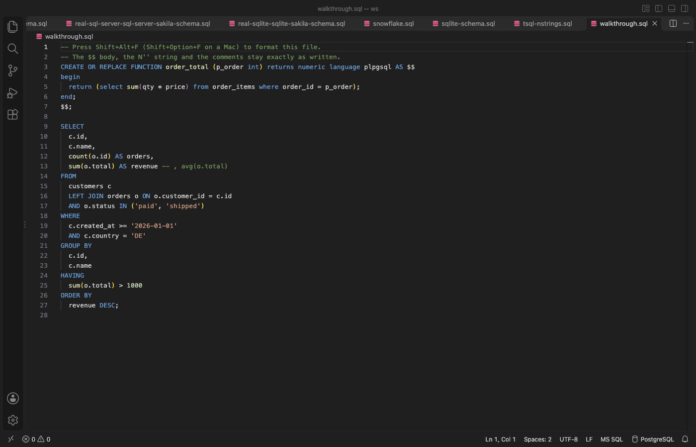
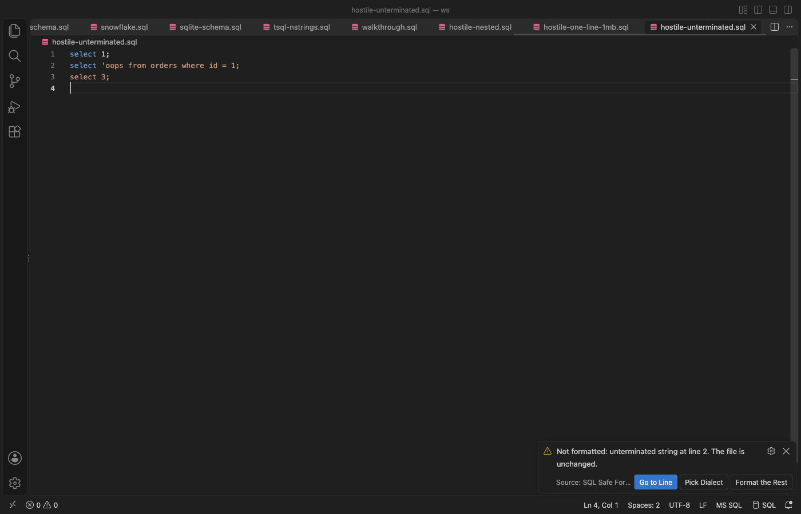
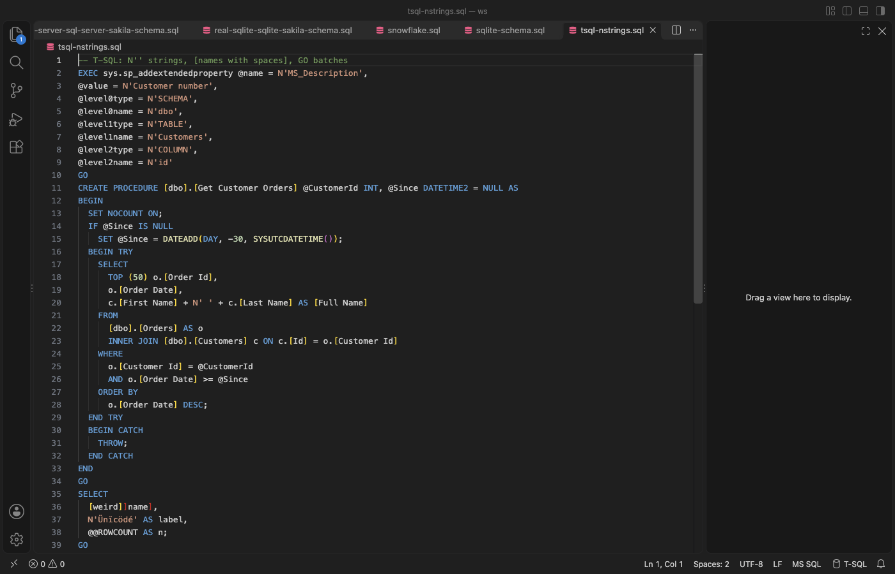

# SQL Safe Formatter & Format on Save for PostgreSQL, MySQL, T-SQL, PL/SQL

Format SQL in VS Code without breaking it. Free, no sign-in, works offline.



- Never changes your code. Each result is checked token by token against your SQL. If anything other than whitespace or keyword case would change, the file stays as it is and a message names the line.
- Keeps what other formatters break: `$$` and `$BODY$` bodies, `DELIMITER $$` blocks, `N'...'` strings, `[names with spaces]`, `` `root`@`localhost` ``, `=>`, commented-out code, `GO` and `/` lines, psql `\` commands and `COPY ... FROM stdin` rows.
- 20 dialects, picked for you from the language mode, the file name or the text: PostgreSQL, MySQL, MariaDB, T-SQL, Oracle PL/SQL, SQLite, BigQuery, Snowflake, Redshift, Spark, Hive, Db2, DuckDB, Trino, ClickHouse and more.
- Stored procedures indented by block, with BEGIN/END, IF/ELSE, loops, DECLARE, EXCEPTION and package bodies.
- Large files work. A 5 MB script took 3.5 to 6 seconds in real VS Code tests (4 threads), with a Cancel button. VS Code stays responsive, because formatting runs outside the editor's process.

## Use it

- To format a file, press Shift+Alt+F (Shift+Option+F on a Mac), or right-click and choose Format Document.
- To format a selection, select lines and press Cmd+K Cmd+F (Ctrl+K Ctrl+F), or choose Format Selection.
- To format on save, add this to your settings.

  ```json
  "[sql]": {
    "editor.formatOnSave": true,
    "editor.defaultFormatter": "zovo.zovo-sql-formatter"
  }
  ```

- To pick the dialect, click the dialect in the status bar (for example `PostgreSQL`). The choice is kept for that file. The setting `sqlFormatter.dialect` sets it for all files.
- For SQL inside a string (Python, JavaScript, Java, C#, Go, PHP), select the SQL or put the cursor in the string, then right-click and choose Format SQL in String.

## When it does not format



The file is left as it is when:

- the SQL cannot be read in the chosen dialect (the message names the line, and Pick Dialect tries another one),
- the result would change a token (a string, a name, an operator or a comment),
- the text is nested too deep, or formatting takes longer than the time limit (30 seconds by default).

Format the Rest formats every statement it can read and keeps the others exactly as written. With format on save, the same message shows only once a minute and then moves to the status bar.

## Stored procedures



Plain statements inside a procedure are formatted as usual. Control lines go on their own lines and the body is indented by block. MySQL `DELIMITER` sections, T-SQL `GO` batches and Oracle `/` lines are kept.

## Why this one

Reviews of two popular SQL formatter listings report these problems. Each one has a test in this repository.

| Review | What this extension does | Test |
| --- | --- | --- |
| "It doesn't work for pl/sql. $$ becomes $ $" ([reviews, 2025-04 and 2024-10](https://marketplace.visualstudio.com/items?itemName=adpyke.vscode-sql-formatter&ssr=false#review-details)) | `$$`, `$tag$` and `$BODY$` bodies are kept byte for byte in every dialect | `$$ bodies stay byte for byte` |
| "Turns DELIMITER $$ into DELIMITER $ $" ([review, 2023-12](https://marketplace.visualstudio.com/items?itemName=adpyke.vscode-sql-formatter&ssr=false#review-details)) | `DELIMITER` lines are kept, and each statement in the section is formatted on its own | `DELIMITER $$ lines ... are kept` |
| "Space between N ' not allowed" ([review, 2023-06](https://marketplace.visualstudio.com/items?itemName=adpyke.vscode-sql-formatter&ssr=false#review-details)) | `N'...'`, `E'...'`, `X'...'` and `q'[...]'` strings are never split | `N'...' strings keep the N` |
| "will format commented out code's comma ... and error the code" ([review, 2026-03](https://marketplace.visualstudio.com/items?itemName=inferrinizzard.prettier-sql-vscode&ssr=false#review-details)) | Comments are compared before and after; a comma in a comment is never moved, also with leading commas | `commented-out code with commas` |
| "does not appear to handle escaped (square brackets) column names when they contain spaces" ([review, 2026-01](https://marketplace.visualstudio.com/items?itemName=inferrinizzard.prettier-sql-vscode&ssr=false#review-details)) | `[first name]`, `[x]]y]` and `` `full name` `` are kept as written | `[bracket names] with spaces` |
| "Crashed vscode and lost $$$" ([review, 2025-08](https://marketplace.visualstudio.com/items?itemName=inferrinizzard.prettier-sql-vscode&ssr=false#review-details)) | Formatting runs in a worker thread with a time limit; a failure leaves the file unchanged | `the time limit stops the worker`, `10,000 nested parentheses are refused` |
| "Not good at all with procedures or functions. Indents at the wrong place." ([review, 2024-09](https://marketplace.visualstudio.com/items?itemName=inferrinizzard.prettier-sql-vscode&ssr=false#review-details)) | Procedures, functions, triggers and packages are indented by block | `procedures are indented by block`, `PL/SQL package body` |
| "Doesn't work for postgre" ([review, 2026-09](https://marketplace.visualstudio.com/items?itemName=adpyke.vscode-sql-formatter&ssr=false#review-details)) | 20 dialects with detection from the file and its text | `the text picks the dialect` |

This extension uses the open source [sql-formatter](https://github.com/sql-formatter-org/sql-formatter) library (MIT) for plain statements. The checks, the dialect detection, the procedure layout and the client-line handling are its own.

## Settings

| Setting | Default | What it does |
| --- | --- | --- |
| `sqlFormatter.dialect` | `auto` | Dialect for all files |
| `sqlFormatter.keywordCase` | `upper` | `upper`, `lower` or `preserve` |
| `sqlFormatter.dataTypeCase`, `sqlFormatter.functionCase` | `preserve` | Case of data types and function names |
| `sqlFormatter.commaPosition` | `trailing` | `trailing` (`a,`) or `leading` (`, b`) |
| `sqlFormatter.maxLineWidth` | `60` | Lists shorter than this stay on one line |
| `sqlFormatter.indentStyle` | `standard` | `standard`, `tabularLeft` or `tabularRight` |
| `sqlFormatter.useEditorIndent` | `true` | Use the editor's tab size and tabs or spaces |
| `sqlFormatter.linesBetweenQueries` | `1` | Empty lines between statements |
| `sqlFormatter.logicalOperatorNewline` | `before` | AND and OR at the start or the end of a line |
| `sqlFormatter.procedureLayout` | `true` | Indent procedures by block |
| `sqlFormatter.maxFileSizeMB` | `16` | Largest file to format as a whole |
| `sqlFormatter.timeLimitSeconds` | `30` | Stop and leave the file unchanged after this time |
| `sqlFormatter.threads` | `0` | Threads for files of 256 KB and up (0 picks up to 4) |

## Privacy

No network access, no telemetry, no account. The extension reads only the file you format.

## Support Zovo

Zovo extensions are free, with no ads and no tracking. They are made by [theluckystrike](https://github.com/theluckystrike) on GitHub. If this one saves you time, you can support the work:

- [Sponsor on GitHub](https://github.com/sponsors/theluckystrike)
- [PayPal](https://www.paypal.com/paypalme/najzzz)
- [Follow theluckystrike on GitHub](https://github.com/theluckystrike)

## More tools by Zovo

- [SQLite DB Viewer & SQLite Viewer, Database Viewer (Read-Only)](https://marketplace.visualstudio.com/items?itemName=zovo.sqlite-table-viewer) browses SQLite tables read-only and runs SELECT queries.
- [XLSX Viewer for Excel, CSV & Parquet](https://marketplace.visualstudio.com/items?itemName=zovo.table-viewer-vscode) opens CSV, TSV, Excel and Parquet files as a sortable, filterable table.
- [Large JSON Viewer, JSON Browser & JSON Tree](https://marketplace.visualstudio.com/items?itemName=zovo.zovo-json-tree-viewer) shows large JSON files as a searchable tree, copies JSONPath and turns arrays of objects into a table.
- [JSONL Viewer, Large JSONL Table & NDJSON Viewer](https://marketplace.visualstudio.com/items?itemName=zovo.zovo-jsonl-viewer) opens JSONL and NDJSON files as a table, as records or as a chat view.
- [Avro Viewer, Apache Arrow Viewer & Feather Viewer](https://marketplace.visualstudio.com/items?itemName=zovo.arrow-avro-viewer) opens Avro, Arrow and Feather files as a paged table.

See [all Zovo extensions on the Marketplace](https://marketplace.visualstudio.com/publishers/zovo).

## License

MIT. The bundled sql-formatter library is MIT licensed (see `vendor/sql-formatter.LICENSE`).

## More from zovo

- [All free zovo VS Code extensions](https://marketplace.visualstudio.com/publishers/zovo) — file viewers, database clients, formatters. Offline, no telemetry, no sign-up.
- [Full MCP server catalogue](https://theluckystrike.github.io/mcp/) — local-first MCP servers for back-office work: invoices, VAT, PDFs, spreadsheets, payroll.
- [Hosted no-install MCP endpoints](https://mcp.zovo.one) — paste a URL in Claude / Cursor, nothing to install.
